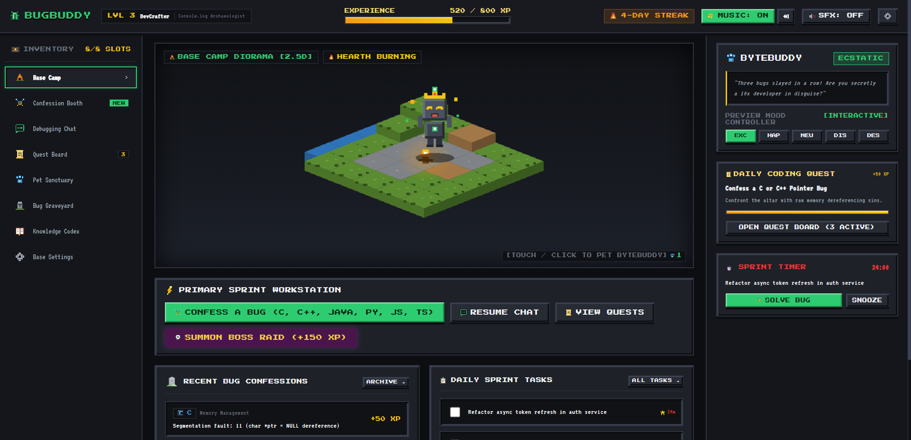
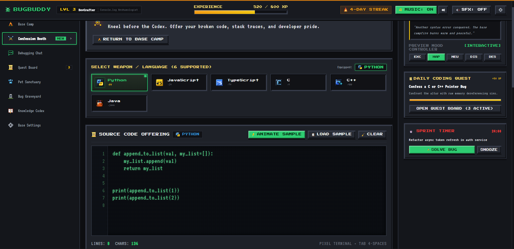
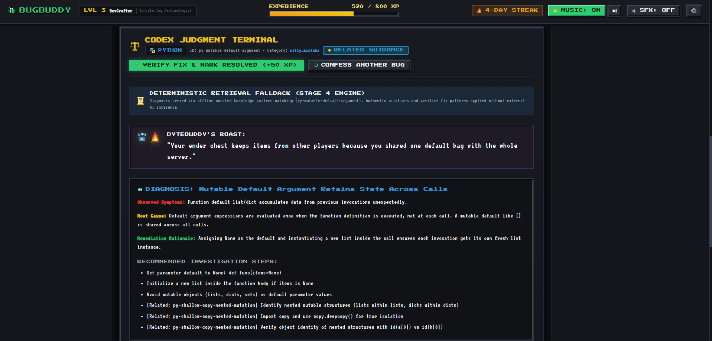
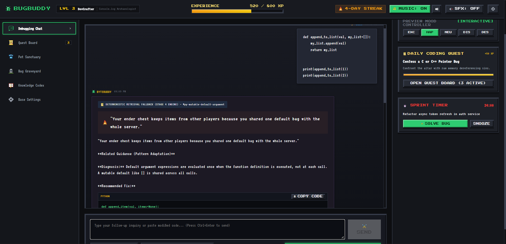
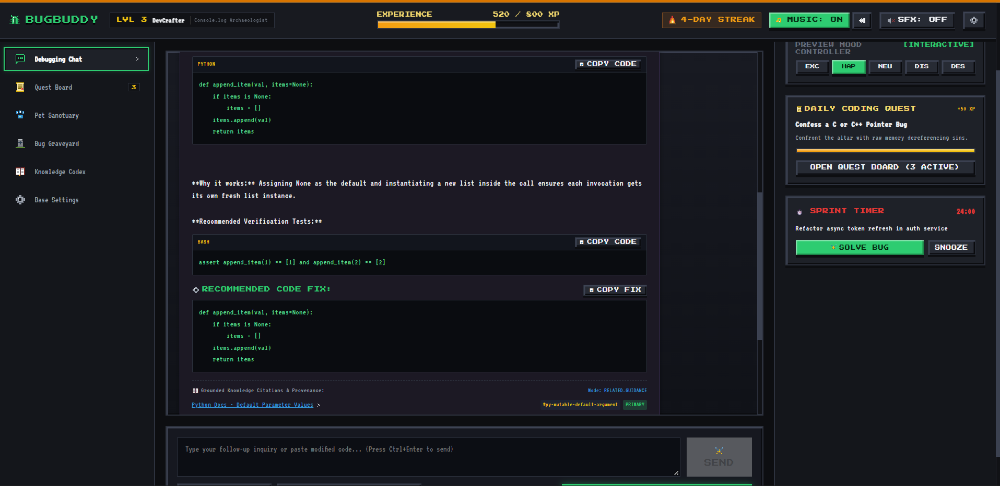
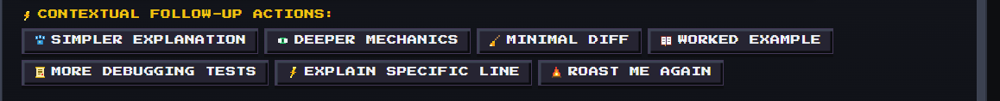
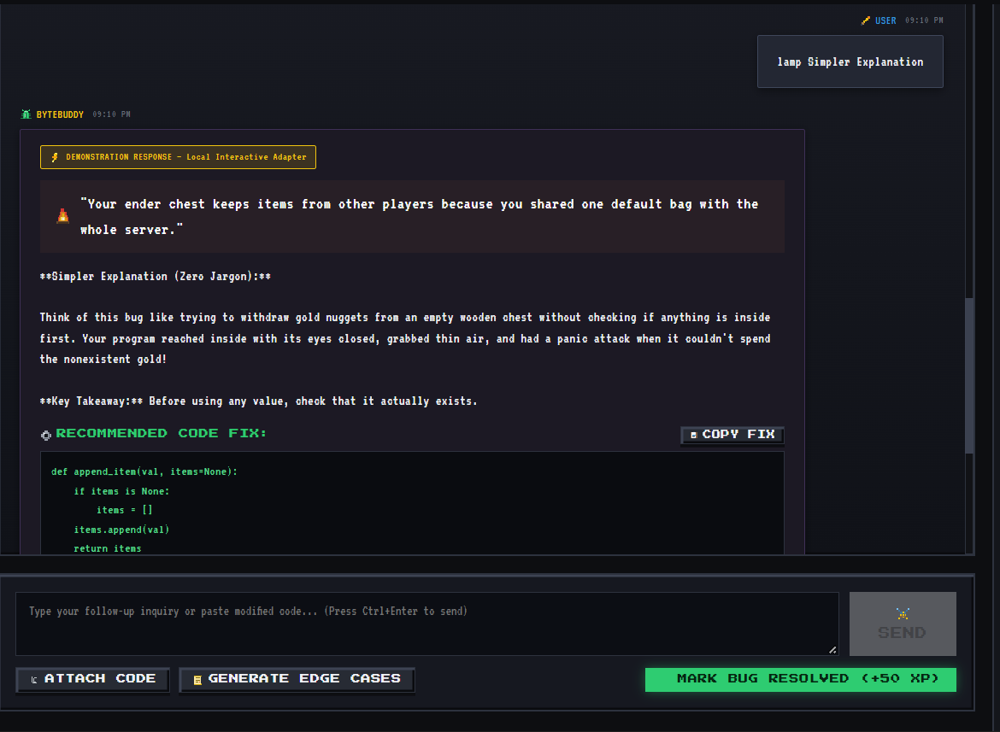
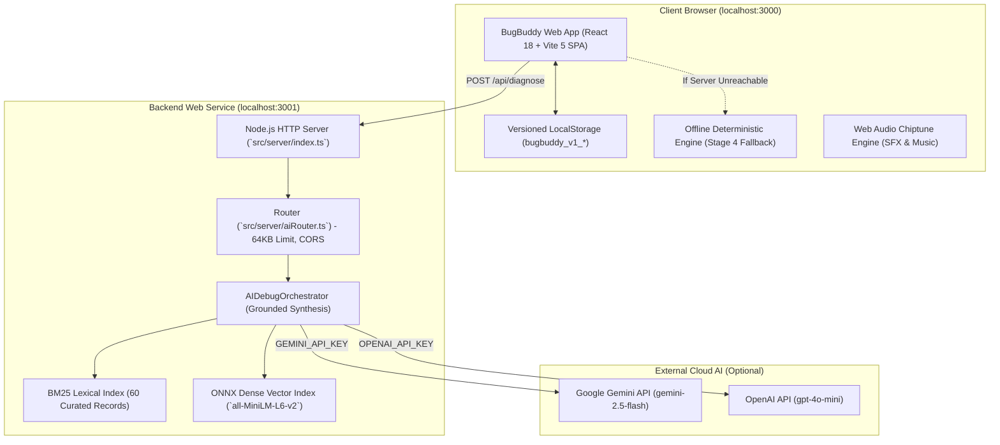

# BugBuddy 🐛⚡

> **"Your bugs are fixable. Your pet's disappointment is optional."**

[](https://hacktoberfest.com/)
[](https://mlh.io/)
[](https://cursor.com/)
[](releases/v0.1.0/)
[](releases/v0.1.0/QA_REPORT.md)
[](knowledge/)
[](https://www.typescriptlang.org/)
[](https://react.dev/)
[](LICENSE)

---

### 🏆 Hackathon Spotlight: Hacktoberfest Global Hack Day (MLH x DEV Community)

> **Challenge 1: Build a Mini App with Cursor**  
> **Sprint Duration**: Built in a **single-day hackathon sprint (24 Hours)**  
> **AI Pair Programmer**: **100% scaffolded, engineered, and tested with [Cursor](https://cursor.com/)**

BugBuddy was built from scratch in a single day for the **Hacktoberfest Global Hack Day**, organized by **Major League Hacking (MLH)** in collaboration with the **DEV Community**. Tackling *Challenge 1 (Build with Cursor)*, we pushed the boundaries of rapid AI pair-programming: taking an ambitious idea—a **Minecraft-inspired gamified debugging companion backed by a grounded multi-lingual RAG chatbot and local ONNX vector embeddings**—from a blank workspace to a fully tested, production-grade application featuring **202 automated assertions**, 60 curated knowledge records, and zero external runtime UI dependencies.

---

## 📸 Product Tour & Showcase

Experience the full journey of BugBuddy across its developer survival world:

### 1. Base Camp Living World & Virtual Pet Companion
The central 2.5D isometric world stage where your companion **ByteBuddy** lives. Your productivity, solved bugs, and sprint tasks dynamically dictate ByteBuddy's emotional mood states.



---

### 2. The Bug Confession Booth (Altar of Penance)
Submit your buggy code across 6 supported programming languages (**C, C++, Java, Python, JavaScript, TypeScript**). Features client-side automatic secret redaction (`scanAndRedactSecrets`) to scrub API keys, JWTs, and tokens before they leave the browser.



---

### 3. Satirical Roast & Grounded Technical Diagnosis
Get roasted with witty, good-natured developer humor, followed immediately by an authentic, mathematically grounded technical fix: root-cause diagnosis, minimal unified diffs, why the fix works, verification test cases, and real documentation citations.



---

### 4. Interactive RAG Debugging Chatbot Workbench
Continue debugging in a persistent multi-turn conversational chat. Powered by hybrid retrieval (BM25 + dense ONNX vector embeddings) with genuine source provenance and zero fabricated links.

| Conversational Multi-Turn Chat | Deep Explanations & Citations |
| :---: | :---: |
|  |  |

---

### 5. Instant Follow-Up Action Chips
Dive deeper into any bug with one-click action chips: `Make it simpler`, `Go deeper`, `Show minimal diff`, `Worked example`, `More tests`, `Explain line-by-line`, or `Roast me again`.




---

## ⚡ Built in 1 Day with Cursor: The AI Pair Programming Story

Building a full-stack, RAG-grounded application in 24 hours required a disciplined, high-velocity AI workflow. Here is how **Cursor** served as the ultimate engineering copilot from minute zero to final release:

```
┌────────────────────────────────────────────────────────────────────────┐
│                   THE 24-HOUR CURSOR SPRINT TIMELINE                   │
├────────────────────────────────────────────────────────────────────────┤
│ 00:00 - 04:00 │ Scaffolding & Architecture (Vite + Node + Types)       │
│ 04:00 - 08:00 │ Curating 60 Knowledge Records across 6 Languages       │
│ 08:00 - 13:00 │ Building the Local Hybrid RAG Engine (BM25 + ONNX RRF) │
│ 13:00 - 17:00 │ Developing Multi-Turn Chatbot & 7 Follow-Up Chips      │
│ 17:00 - 20:00 │ Minecraft UI, Web Audio Chiptunes & Ender Boss Raid    │
│ 20:00 - 24:00 │ Zero-Tolerance QA: Generating 202 Passing Tests        │
└────────────────────────────────────────────────────────────────────────┘
```

### 1. Zero-to-One Project Scaffolding
Using Cursor's Chat and Composer, we began from an empty folder. We prompted Cursor with our design tokens, architectural boundaries, and type safety constraints. Cursor drafted:
- Clean TypeScript configurations and strict contracts (`src/types/index.ts`).
- Dual-server setup: React 18 + Vite 5 frontend on port 3000, and standalone Node.js HTTP server on port 3001.
- Tactile Minecraft-inspired CSS design system in vanilla CSS (`src/styles/pixel-ui.css`) with zero heavy CSS framework bloat.

### 2. Engineering the Entire RAG Knowledge Retrieval Pipeline
To make BugBuddy truthful and prevent hallucinated debugging advice, we built a complete two-tier retrieval system:
- **Curated Corpus**: Cursor helped structure and validate **60 high-signal knowledge records** covering critical language footguns in C, C++, Java, Python, JavaScript, and TypeScript.
- **BM25 Okapi Algorithm**: Implemented a zero-dependency lexical search engine (`src/knowledge/search.ts`) with custom tokenization, stopword filtering, and length normalization.
- **Local Dense Embeddings with ONNX**: Integrated `@xenova/transformers` running `all-MiniLM-L6-v2` locally on Node.js with cosine similarity vector scoring.
- **Hybrid Fusion**: Cursor implemented **Reciprocal Rank Fusion (RRF)** to combine sparse BM25 and dense vector results into a unified evidence ranking.

### 3. Crafting the RAG Chatbot & Action Chips
Cursor allowed us to build the multi-turn debugging chat in record time:
- Seamless streaming and structured payload generation (`ConfessionResult`).
- The 7 interactive follow-up chips (`simpler`, `deeper`, `minimal_diff`, `worked_example`, `more_tests`, `explain_line`, `roast_again`) were wired directly into the knowledge retrieval service.
- Client-side privacy filter (`src/utils/secretRedactor.ts`) that regex-scans and redacts API keys, JWTs, and passwords before anything is transmitted.

### 4. Minecraft Pixel UI, Web Audio Synthesizers & Boss Raid
- **Handcrafted Pixel SVGs**: Cursor generated crisp 16x16 and 64x64 pixel art vectors for the companion ByteBuddy, language emblems, and the Ender Dragon boss.
- **Web Audio API Procedural Chiptunes**: Zero external `.mp3` dependencies. Cursor synthesized square, sawtooth, and triangle waves for retro 8-bit jump, level-up, boss roar, dragon breath, and pet chirp sounds.
- **Ender Dragon Boss Raid**: Added a multi-wave boss fight modal with 10-segmented boss health bar, combat logs, and victory rewards (+150 XP).

### 5. Rapid Test-Driven Verification (202 Passing Tests)
Instead of manually clicking through features, we used Cursor to write comprehensive automated test suites using Node's native test runner (`tsx --test`):
- Language adapters, ingestion schema validation, BM25 scoring, hybrid fusion, secret redactor, UI static markup rendering, and combat state transitions.
- **Result**: **202 automated assertions across 30 test suites passing 100% cleanly!**

---

## 📌 Table of Contents

- [The Problem & The Solution](#-the-problem--the-solution)
- [Visual Direction & World Metaphor](#-visual-direction--world-metaphor)
- [Feature Matrix](#-feature-matrix)
- [Supported Languages](#-supported-languages)
- [System Architecture](#-system-architecture)
- [Technology Stack](#-technology-stack)
- [Quickstart & Local Setup](#-quickstart--local-setup)
- [Environment Configuration](#-environment-configuration)
- [Testing & Quality Assurance](#-testing--quality-assurance)
- [Deployment Readiness](#-deployment-readiness)
- [Security & Limitations](#-security--limitations)
- [Documentation Index](#-documentation-index)
- [License](#-license)

---

## 💡 The Problem & The Solution

### The Problem
Debugging software is frustrating, lonely, and mentally exhausting:
1. **Silent Isolation**: Developers spend hours staring at cryptic compiler outputs or stack traces in total isolation.
2. **The Procrastination Spiral**: Intimidating bugs prompt tab-switching to social media, draining velocity.
3. **Fluffy, Sycophantic AI**: Generic commercial AI assistants bury root causes under polite conversational fluff (*"I'd love to help with that great question!"*) and hallucinate package APIs.
4. **Zero Emotional Reward**: Standard issue trackers and IDEs provide zero dopamine for fixing stubborn bugs.

### The Solution
BugBuddy blends tough love with pragmatic software engineering:
1. **The Bug Confession Booth (Altar of Penance)**: Submit code snippets across six languages. Get a satirical roast targeting bad habits, followed immediately by structured root-cause diagnosis, minimal diffs, and reproducible tests.
2. **Grounded Multi-Turn Chatbot**: Continue exploring the bug interactively with source-backed citations from canonical language specifications.
3. **The Procrastination Pet (ByteBuddy Cyber-Golem)**: Adopt an animated pixel-art companion whose mood reflects your real-world progress. Resolving bugs and finishing sprint quests awards XP and levels up your pet; neglecting tasks plunges your pet into despair!
4. **Ender Dragon Boss Raids**: Slay monumental multi-wave boss bugs in retro RPG combat for massive XP payouts!

---

## 🚀 Feature Matrix

| Feature | Status | Description |
| :--- | :---: | :--- |
| **Bug Confession Booth** | ✅ Implemented | Code editor, language selector, client secret scrubbing, and JudgmentTerminal. |
| **Satirical Roast Engine** | ✅ Implemented | Sarcastic, ego-bruising developer roasts paired with respectful technical fixes. |
| **Grounded Diagnostic RAG** | ✅ Implemented | BM25 keyword matching + dense ONNX vector search fused with Reciprocal Rank Fusion. |
| **Interactive Debugging Chat** | ✅ Implemented | Multi-turn chat with 7 action chips (`Simpler`, `Deeper`, `Minimal Diff`, etc.). |
| **ByteBuddy Virtual Pet** | ✅ Implemented | 5 emotional mood states, Web Audio chiptune synthesizer, Feed/Pet/Play interactions. |
| **Pet Wardrobe & Customization** | ✅ Implemented | Equip Diamond Helmet, Wizard Hat, Night Cap, or Crown with dance and spin tricks! |
| **Ender Dragon Boss Raid** | ✅ Implemented | Turn-based RPG boss encounter with segmented boss bar, multi-wave attacks, and +150 XP. |
| **Quest Board & Daily Sprints** | ✅ Implemented | Daily quests and sprint goals awarding XP with real-time level progression. |
| **Bug Graveyard Archive** | ✅ Implemented | Tombstone history of slayed bugs with category filtering and persistent storage. |
| **Knowledge Codex** | ✅ Implemented | Searchable index of all 60 curated knowledge records with source citation modals. |
| **Settings & Accessibility** | ✅ Implemented | Clean Sans-Serif font toggle, High Contrast mode, Audio mute, and Local Storage wipe. |
| **Server-Side AI Integration** | ✅ Implemented | Node.js backend supporting Google Gemini, OpenAI, and Mock providers with 64KB boundary. |

---

## 💻 Supported Languages

BugBuddy ships with first-class, verified support for six programming languages:
- **C**: Memory leaks, pointer arithmetic, buffer overflows, format string specifiers.
- **C++**: Object lifecycles, RAII violations, template metaprogramming errors, smart pointer circular references.
- **Java**: NullPointerExceptions, thread concurrency hazards, collection mutation contracts.
- **Python**: Mutable default arguments, generator exhaustion, GIL misconceptions, indentation traps.
- **JavaScript**: Type coercion pitfalls, event loop starvation, unhandled async promise rejections.
- **TypeScript**: Discriminated union narrowing, excessive type recursion, readonly mutations.

---

## 🏗️ System Architecture



Explore the detailed architecture diagrams in [`docs/architecture/diagrams/`](docs/architecture/diagrams/).

---

## 🛠️ Technology Stack

- **Frontend**: React 18.3, TypeScript 5.6, Vite 5.4, Vanilla CSS Custom Properties (Zero Tailwind/Bootstrap overhead).
- **Backend**: Node.js 20+ (`node:http`), `tsx` high-performance runtime.
- **Embeddings & Vector Search**: `@xenova/transformers` (Transformers.js 2.17) running ONNX `all-MiniLM-L6-v2` locally.
- **Lexical Search**: Custom BM25 Okapi implementation with language-specific tokenizers.
- **Audio Synthesis**: Pure Web Audio API procedural oscillator synthesis (zero external audio asset files).
- **AI Providers**: Google Gemini REST API, OpenAI Chat Completions API, Deterministic Mock Fallback.
- **Testing**: Node.js Native Test Runner (`tsx --test`) with 202 assertions.

---

## 🚀 Quickstart & Local Setup

### 1. Prerequisites
- Node.js `20.x` or higher
- npm `10.x` or higher

### 2. Installation
```bash
git clone https://github.com/Subhadip-Paul2006/BugBuddy.git
cd BugBuddy
npm install
```

### 3. Launching Locally
```bash
# Terminal 1: Start Backend Server
npm start
# Server listens at http://0.0.0.0:3001 (Health check: http://localhost:3001/health)

# Terminal 2: Start Frontend Development Server
npm run dev
# Open http://localhost:3000 in your browser
```

Full setup instructions: [docs/SETUP.md](docs/SETUP.md).

---

## ⚙️ Environment Configuration

BugBuddy works **100% offline out of the box** using its local deterministic RAG engine and built-in knowledge base.

To connect live cloud AI providers, copy `.env.example` to `.env`:
```bash
cp .env.example .env
```
Key configuration parameters:
- `PORT`: Server port (default `3001`).
- `HOST`: Server interface binding (default `0.0.0.0`).
- `CORS_ORIGIN`: Allowed frontend origin (e.g. `http://localhost:3000` or `*`).
- `DEFAULT_AI_PROVIDER`: Preferred AI model (`gemini`, `openai`, or `mock`).
- `GEMINI_API_KEY`: Google Generative Language API key.
- `OPENAI_API_KEY`: OpenAI API key.

*(See [.env.example](.env.example) for placeholder definitions. Never commit real keys).*

---

## 🧪 Testing & Quality Assurance

BugBuddy enforces complete verification with **202 passing automated tests across 30 test suites**:

```bash
# Run full unit & integration test suite (202 assertions)
npm test

# Ingest and validate all 60 knowledge records
npm run validate:knowledge

# Run BM25 & Hybrid RRF benchmark evaluation
npm run evaluate:retrieval

# Verify local ONNX embedding pipeline
npm run verify:stage6

# Run live AI provider smoke test
npm run smoke:ai

# Execute production TypeScript build
npm run build
```

Full QA audit report: [releases/v0.1.0/QA_REPORT.md](releases/v0.1.0/QA_REPORT.md).

---

## 🔒 Security & Limitations

- **Zero Code Execution**: Code submissions are analyzed statically. User code is never compiled, eval'd, or executed.
- **Client-Side Secret Redaction**: All API keys, passwords, and tokens are scrubbed client-side before leaving the browser.
- **Strict Payload Limits**: 64 KB maximum request size enforced on backend endpoints.
- **State Management**: Player profile, slayed bugs, and quests persist locally in the browser via `localStorage` with versioned keys (`bugbuddy_v1_*`).

Full security policy: [SECURITY.md](SECURITY.md).

---

## 📚 Documentation Index

- [Product Requirements Document (PRD)](PRD.md)
- [Technical Requirements Document (TRD)](TRD.md)
- [Developer Setup Guide](docs/SETUP.md)
- [Architecture & Diagrams](docs/architecture/diagrams/)
- [Production Deployment Guide](docs/DEPLOYMENT.md)
- [Release Process & Quality Gates](docs/RELEASE_PROCESS.md)
- [v0.1.0 Release Candidate Package](releases/v0.1.0/)

---

## 📄 License

This project is open-source under the [MIT License](LICENSE).

---

*Crafted with 💚 and Cursor for Hacktoberfest Global Hack Day 2026 (Major League Hacking x DEV Community).*
