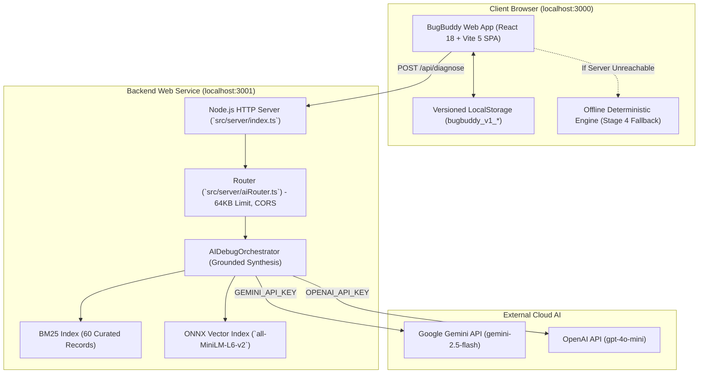

# BugBuddy 🐛⚡

> **"Your bugs are fixable. Your pet's disappointment is optional."**

[](releases/v0.1.0/)
[](releases/v0.1.0/QA_REPORT.md)
[](knowledge/)
[](https://www.typescriptlang.org/)
[](https://react.dev/)
[](https://vitejs.dev/)
[](LICENSE)

BugBuddy is a gamified, AI-powered debugging assistant and developer productivity web application styled as a **Minecraft-Inspired Developer Survival World**. It transforms the soul-crushing experience of chasing cryptic compiler panics, syntax blunders, and runtime exceptions into an entertaining, highly educational, and emotionally accountable quest.

> ℹ️ **Deployment Status**: Current status is **v0.1.0 Release Candidate (Local & Pre-Deployment Verified)**. Cloud deployment to Render is prepared and documented; public demo URLs will be posted upon final release publication.

---

## 📌 Table of Contents

- [The Problem & The Solution](#-the-problem--the-solution)
- [Visual Direction & World Metaphor](#-visual-direction--world-metaphor)
- [Feature Matrix: Implemented vs. Planned](#-feature-matrix)
- [Supported Languages](#-supported-languages)
- [System Architecture](#-system-architecture)
- [Technology Stack](#-technology-stack)
- [Quickstart & Local Setup](#-quickstart--local-setup)
- [Environment Configuration](#-environment-configuration)
- [Testing & Quality Assurance](#-testing--quality-assurance)
- [Deployment Readiness](#-deployment-readiness)
- [Security & Limitations](#-security--limitations)
- [Documentation Index](#-documentation-index)
- [Contributing & Code of Conduct](#-contributing--code-of-conduct)
- [License](#-license)

---

## 💡 The Problem & The Solution

### The Problem
Debugging modern software is frustrating, lonely, and cognitively exhausting:
1. **Silent Isolation**: Developers spend up to 50% of their working hours staring at cryptic compiler outputs or stack traces in total isolation.
2. **The Procrastination Spiral**: Intimidating bugs prompt tab-switching to social media or videos, derailing development velocity.
3. **Sycophantic, Bloated AI**: Generic commercial AI assistants offer corporate pleasantries (*"I'd love to help with this great question!"*), bury the root cause under paragraphs of conversational fluff, and fail to call out bad programming habits.
4. **Zero Emotional Reward**: Standard issue trackers and IDEs are utilitarian databases providing zero dopamine for fixing hard bugs.

### The Solution
BugBuddy blends tough love with pragmatic software engineering through two tightly synchronized subsystems:
1. **The Bug Confession Booth (Altar of Penance)**: Developers submit code snippets or compiler tantrums across six programming languages. They receive a humorous roast targeting code flaws, followed immediately by structured root-cause diagnosis, minimal diffs, and reproducible verification tests.
2. **The Procrastination Pet (ByteBuddy Cyber-Golem)**: Users adopt an animated pixel-art coding companion whose emotional well-being reflects their real-world productivity. Resolving bugs and finishing quests awards XP, levels up the pet, and triggers celebrations. Neglecting tasks plunges the pet into expressive despair.

---

## ⛏️ Visual Direction & World Metaphor

BugBuddy rejects generic corporate dashboards in favor of an original **Minecraft-Inspired Developer Survival World**:
- **The Base Camp**: Your developer sanctuary featuring a cozy pixel-art hearth where your virtual pet rests and reacts.
- **Voxel Depth & Blocky Borders**: Deepslate (`#121417`), cobblestone (`#2B2D31`), and obsidian surfaces with tactile beveled pixel borders.
- **Inventory Hotbars**: A persistent 8-slot developer inventory sidebar and HUD displaying player level, XP progress, and active streak campfire.
- **Hostile Mobs as Bugs**: Bugs and syntax errors are treated as hostile encounters; resolving them awards golden XP orbs.
- **Material Accents**: Emerald green (`#2ECC71`) for success/actions, Redstone crimson (`#E53935`) for errors, and Gold (`#F1C40F`) for XP and quests.
- *Detailed specification*: See [docs/UI_UX.md](docs/UI_UX.md).

```
┌───────────────────────────────────────────────────────────────┐
│                    [PRODUCT SCREENSHOT]                       │
│    (Interactive Minecraft HUD, ByteBuddy Pet, Altar Altar)    │
│                                                               │
│       [Placeholder: Add production screenshot upon deploy]    │
└───────────────────────────────────────────────────────────────┘
```

---

## 🚀 Feature Matrix

| Feature | Status | Description |
| :--- | :---: | :--- |
| **Bug Confession Booth** | ✅ Implemented | Code editor, language selector, client secret scrubbing, and JudgmentTerminal. |
| **Satirical Roast Engine** | ✅ Implemented | Sarcastic, ego-bruising developer roasts paired with respectful technical fixes. |
| **Grounded Diagnostic RAG** | ✅ Implemented | BM25 keyword matching + dense ONNX vector search fused with Reciprocal Rank Fusion. |
| **Interactive Debugging Chat** | ✅ Implemented | Multi-turn chat with 7 action chips (`Simpler`, `Deeper`, `Worked Example`, etc.). |
| **ByteBuddy Virtual Pet** | ✅ Implemented | 5 emotional mood states, Web Audio chiptune synthesizer, Feed/Pet/Play interactions. |
| **Quest Board & Daily Sprints** | ✅ Implemented | Daily quests and sprint goals awarding XP with real-time level progression. |
| **Bug Graveyard Archive** | ✅ Implemented | Tombstone history of slayed bugs with category filtering and persistent storage. |
| **Knowledge Codex** | ✅ Implemented | Searchable index of all 60 curated knowledge records with source citation modals. |
| **Settings & Accessibility** | ✅ Implemented | Clean Sans-Serif font toggle, High Contrast mode, Audio mute, and Local Storage wipe. |
| **Server-Side AI Integration** | ✅ Implemented | Node.js backend supporting Google Gemini, OpenAI, and Mock providers with 64KB boundary. |
| **Boss Fight / Bug Raids** | ⏳ Planned | Ender Dragon boss encounter modal & cooperative team debugging raids (Phase 4). |
| **Cloud User Accounts** | ⏳ Planned | Multi-device cloud sync and persistent user authentication (Phase 5). |

---

## 💻 Supported Languages

BugBuddy ships with first-class support for six canonical programming languages:
- **C**: Memory management, pointer arithmetic, buffer overflows, format string specifiers.
- **C++**: Object lifecycles, RAII violations, template errors, smart pointer circular references.
- **Java**: NullPointerExceptions, concurrency pitfalls, collection mutation contracts.
- **Python**: Mutable default arguments, generator exhaustion, GIL misconceptions, indent errors.
- **JavaScript**: Type coercion traps, event loop starvation, unhandled async promise rejections.
- **TypeScript**: Discriminated union narrowing, excessive type recursion, readonly mutations.

---

## 🏗️ System Architecture



For detailed architecture diagrams, explore [`docs/architecture/diagrams/`](docs/architecture/diagrams/).

---

## 🛠️ Technology Stack

- **Frontend**: React 18.3, TypeScript 5.6, Vite 5.4, Vanilla CSS Design System (no Tailwind soup).
- **Backend**: Node.js 20+ (`node:http`), `tsx` runtime.
- **Embeddings & Vector**: Transformers.js (`@xenova/transformers` 2.17) with ONNX `all-MiniLM-L6-v2`.
- **Audio System**: Web Audio API Chiptune 8-bit Procedural Synthesizer.
- **AI Providers**: Google Gemini REST API, OpenAI Chat Completions API, Deterministic Mock Engine.
- **Testing**: Node.js Native Test Runner (`tsx --test`).

---

## 🚀 Quickstart & Local Setup

### 1. Prerequisites
- Node.js `20.x` or higher
- npm `10.x` or higher

### 2. Installation
```bash
git clone https://github.com/Subhadip-Paul2006/BugBuddy.git
cd BugBuddy
npm install
```

### 3. Launching Locally
```bash
# Terminal 1: Start Backend Server
npm start
# Listens at http://0.0.0.0:3001 (Health check: http://localhost:3001/health)

# Terminal 2: Start Frontend Development Server
npm run dev
# Open http://localhost:3000 in your browser
```

Full setup instructions: [docs/SETUP.md](docs/SETUP.md).

---

## ⚙️ Environment Configuration

BugBuddy works **completely offline with rich mock heuristics out of the box** without any external API keys.

To connect real cloud AI providers, copy `.env.example` to `.env`:
```bash
cp .env.example .env
```
Key configuration parameters:
- `PORT`: Server port (default `3001`).
- `HOST`: Server interface binding (default `0.0.0.0`).
- `CORS_ORIGIN`: Allowed frontend origin (e.g. `https://bugbuddy.onrender.com` or `*`).
- `DEFAULT_AI_PROVIDER`: Preferred AI model (`gemini`, `openai`, or `mock`).
- `GEMINI_API_KEY`: Google Generative Language API key.
- `OPENAI_API_KEY`: OpenAI API key.
- `VITE_API_BASE_URL`: Base URL for production deployed backend.

*(See [.env.example](.env.example) for placeholder definitions. Never commit real keys).*

---

## 🧪 Testing & Quality Assurance

All quality gates are automated and verifiable:

```bash
# Run unit & integration test suite (192 assertions, 27 suites)
npm test

# Ingest and validate all 60 knowledge records
npm run validate:knowledge

# Run BM25 & Hybrid RRF benchmark evaluation
npm run evaluate:retrieval

# Verify local ONNX embedding pipeline
npm run verify:stage6

# Run live AI smoke test / fallback verification
npm run smoke:ai

# Execute production TypeScript build
npm run build
```

Full QA audit report: [releases/v0.1.0/QA_REPORT.md](releases/v0.1.0/QA_REPORT.md).

---

## 🚢 Deployment Readiness

BugBuddy is configured for zero-friction deployment to **Render** via [render.yaml](render.yaml):
- **Frontend**: Render Static Site (`bugbuddy-frontend`), build command `npm install && npm run build`, publish dir `dist`, SPA rewrite rule `/* -> /index.html`.
- **Backend**: Render Web Service (`bugbuddy-backend`), start command `npm start`, health check `/health`.

Step-by-step instructions: [docs/DEPLOYMENT.md](docs/DEPLOYMENT.md).

---

## 🔒 Security & Limitations

- **No Code Execution**: Submissions are analyzed statically. User code is never compiled, eval'd, or executed on the server.
- **Client-Side Secret Redaction**: All API keys, passwords, and tokens are scrubbed client-side before submission.
- **Payload Limits**: 64 KB maximum request size enforced on backend endpoints.
- **Current Limitations**: Cloud AI features require valid server-side API keys. Player stats are stored locally in the browser (`localStorage`) without multi-device cloud sync.

Full security policy: [SECURITY.md](SECURITY.md).

---

## 📚 Documentation Index

- [Product Requirements Document (PRD)](PRD.md) | [docs/PRD.md](docs/PRD.md)
- [Technical Requirements Document (TRD)](TRD.md) | [docs/TRD.md](docs/TRD.md)
- [Developer Setup Guide](docs/SETUP.md)
- [Architecture & Diagrams](docs/architecture/diagrams/)
- [Architecture Workflow & Archify Status](docs/ARCHITECTURE_WORKFLOW.md)
- [Production Deployment Guide](docs/DEPLOYMENT.md)
- [Release Process & Quality Gates](docs/RELEASE_PROCESS.md)
- [v0.1.0 Release Candidate Package](releases/v0.1.0/)

---

## 🤝 Contributing & Code of Conduct

We welcome community contributions! Please review:
- [CONTRIBUTING.md](CONTRIBUTING.md) for pull request and coding standards.
- [CODE_OF_CONDUCT.md](CODE_OF_CONDUCT.md) for community standards.
- [SECURITY.md](SECURITY.md) for responsible vulnerability disclosure.

---

## 📄 License

This project is licensed under the MIT License — see the [LICENSE](LICENSE) file for details.
