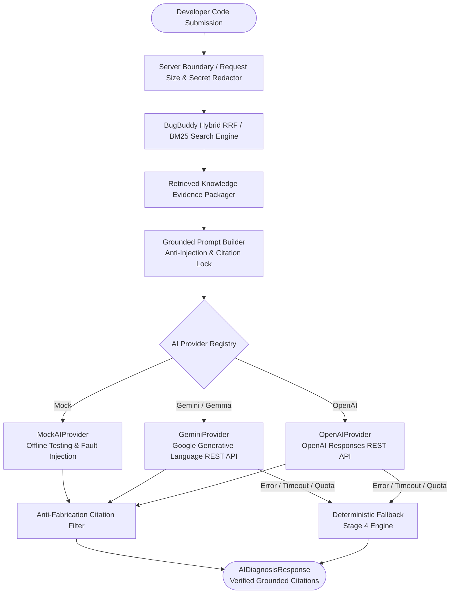

# BugBuddy Knowledge Base — Architecture, Schema & Ingestion Guide

**Document Version:** 8.0.0  
**Target Audience:** BugBuddy Developers, Knowledge Curators, AI Engine Engineers  
**Directory Location:** `docs/KNOWLEDGE_BASE.md`  

---

## 1. Overview

BugBuddy uses a curated, offline-capable debugging knowledge base to power its AI diagnostic engine and sarcastic Minecraft-themed debugging persona. The knowledge system is built with strict TypeScript contracts, deterministic schema validation, cross-file duplicate detection, and automated normalization.

The knowledge system follows an eight-stage progressive roadmap:
- **Stage 1 (Complete):** Curated Knowledge Corpus across six primary programming languages (`c`, `cpp`, `java`, `python`, `javascript`, `typescript`).
- **Stage 2 (Complete):** Metadata Schema and Document Ingestion with strict contract validation and diagnostics reporting.
- **Stage 3 (Complete):** Keyword Retrieval with Language and Category Filters using weighted in-memory BM25.
- **Stage 4 (Complete):** Structured Roast, Diagnosis, Fix, and Test Responses grounded deterministically in retrieved entries.
- **Stage 5 (Complete):** Source Attribution and Retrieval Evaluation with rich provenance and deterministic benchmarking.
- **Stage 6 (Complete):** Optional Embedding-Based Semantic Retrieval and Hybrid Search using Reciprocal Rank Fusion (RRF).
- **Stage 7 (Complete):** AI Provider Integration with Grounded Orchestration, Server-Side Security, and Deterministic Fallback.
- **Stage 8 (Complete):** Knowledge Maintenance, Operational Reliability, Corpus Quality Auditing & Held-Out Benchmark.

---

## 2. Directory Layout

The knowledge base components are organized as follows:

```
BugBuddy/
├── knowledge/                     # Curated debugging knowledge corpus
│   ├── c.json                     # C debugging entries (10 records)
│   ├── cpp.json                   # C++ debugging entries (10 records)
│   ├── java.json                  # Java debugging entries (10 records)
│   ├── javascript.json            # JavaScript debugging entries (10 records)
│   ├── python.json                # Python debugging entries (10 records)
│   └── typescript.json            # TypeScript debugging entries (10 records)
│
├── src/
│   └── knowledge/                 # Knowledge engine implementation
│       ├── index.ts               # Public module export interface
│       ├── types.ts               # Canonical TypeScript interfaces & types
│       ├── schema.ts              # Supported values, aliases, and constants
│       ├── normalizer.ts          # String trimming, alias mapping, search content synthesis
│       ├── validator.ts           # Schema validation and diagnostic generation
│       ├── ingest.ts              # Safe file reading, parsing, and directory ingestion
│       ├── reporter.ts            # Terminal and markdown summary formatting
│       ├── search.ts              # Weighted BM25 retrieval, filtering, and prompt context assembly
│       ├── response.ts            # Structured response engine with rich source attribution
│       ├── evaluationData.ts      # Ground truth evaluation dataset (30 queries across 6 languages)
│       ├── evaluator.ts           # Deterministic retrieval evaluation runner & metric calculations
│       ├── embeddings.ts          # Embedding provider abstractions, models, and local adapters
│       ├── vectorSearch.ts        # In-memory vector index with cosine similarity and dimension checks
│       └── hybridSearch.ts        # Reciprocal Rank Fusion (RRF) combining BM25 & dense vector search
│
├── scripts/
│   ├── validate_knowledge.ts      # Standalone CLI validation script
│   └── evaluate_retrieval.ts      # Standalone CLI retrieval evaluation runner (BM25 & Hybrid)
│
├── tests/
│   ├── knowledge.test.ts          # Stage 2 validation & ingestion test suite (16 tests)
│   ├── knowledgeSearch.test.ts    # Stage 3 search, ranking & retrieval test suite (15 tests)
│   ├── response.test.ts           # Stage 4 structured response engine test suite (17 tests)
│   ├── attribution.test.ts        # Stage 5 attribution & evaluation test suite (13 tests)
│   └── semantic.test.ts           # Stage 6 vector, RRF hybrid & fallback test suite (17 tests)
│
└── docs/
    ├── KNOWLEDGE_BASE_STATUS.md   # Baseline audit, current status, and test report
    └── KNOWLEDGE_BASE.md          # System architecture and schema guide (this document)
```

---

## 3. Canonical Metadata Schema

Every knowledge entry is represented by the `KnowledgeEntry` interface defined in `src/knowledge/types.ts`:

```typescript
export interface KnowledgeSource {
  title?: string;
  url: string;
}

export interface KnowledgeEntry {
  id: string;                      // Unique lowercase kebab-case slug (e.g. 'c-null-ptr-deref')
  language: CanonicalLanguage;     // 'c' | 'cpp' | 'java' | 'python' | 'javascript' | 'typescript'
  title: string;                   // Concise summary of the bug
  category: CanonicalCategory;     // Error category classification
  difficulty: CanonicalDifficulty; // 'beginner' | 'intermediate' | 'advanced'
  symptoms: string;                 // Observable symptoms, compiler errors, or runtime behavior
  roast: string;                    // Sarcastic BugBuddy Minecraft-themed roast
  diagnosis: string;                // Detailed technical root cause explanation
  debuggingSteps: string[];         // Actionable step-by-step troubleshooting guide
  badExample: string;              // Minimal code snippet illustrating the buggy code
  fixedExample: string;            // Corrected code snippet (must differ from badExample)
  whyItWorks: string;              // Technical explanation of why the fix works
  tests: string;                    // Concrete test assertion or verification code
  tags: string[];                  // Search keywords (normalized to lowercase)
  sources: KnowledgeSource[];      // Authoritative documentation sources (valid HTTP/HTTPS)
}
```

### Supported Language Identifiers

Canonical language values and supported aliases (mapped automatically during normalization):

| Canonical Identifier | Aliases Mapped |
| :--- | :--- |
| `c` | `c` |
| `cpp` | `cpp`, `c++`, `cplusplus` |
| `java` | `java` |
| `python` | `python`, `py` |
| `javascript` | `javascript`, `js`, `node`, `nodejs` |
| `typescript` | `typescript`, `ts` |

### Supported Categories

The categories align with BugBuddy's technical requirements specification (`docs/TRD.md` Section 11.2):

- `silly_mistake`: Typos, off-by-one errors, missing return statements, operator confusions.
- `syntax_error`: Malformed grammar or structural syntax issues.
- `runtime_error`: Crashes, segfaults, unhandled exceptions, unhandled Promise rejections.
- `logic_error`: Incorrect algorithmic logic, scope leaks, unexpected state mutations.
- `type_compilation`: Compiler type check failures, generic constraints, excess property errors.
- `incomplete_submission`: Partial code or missing implementations.
- `difficult_ambiguous`: Complex race conditions, lifetime or concurrency subtleties.
- `unsupported_error`: Exotic or architecture-specific failures.

### Supported Difficulties

- `beginner`: Fundamental syntax or simple semantic errors.
- `intermediate`: Standard library pitfalls, concurrency, or memory lifetime hazards.
- `advanced`: Deep compiler edge-cases, undefined behavior, or complex type system mechanics.

---

## 4. Ingestion Workflow

The ingestion pipeline is designed to be deterministic, offline-capable, and safe:

```
[knowledge/*.json]
        │
        ▼
1. Discover Files (ingestKnowledgeDirectory)
        │
        ▼
2. Read & Parse JSON safely (fs.readFile -> JSON.parse)
        │ ── (Catches syntax errors, records file & error message)
        ▼
3. Validate Schema & Business Rules (validateRecord)
        │ ── (Checks required fields, regex, enums, URLs, bad !== fixed)
        │ ── (Tracks seen IDs across all files to detect duplicates)
        ▼
4. Normalize Valid Records (normalizeRecord)
        │ ── (Maps aliases, trims strings, produces searchContent)
        ▼
5. Output IngestionResult
        ├── success: boolean
        ├── totalRecords: number
        ├── recordsByLanguage: Record<CanonicalLanguage, number>
        ├── records: NormalizedKnowledgeRecord[]
        ├── errors: ValidationError[]
        └── warnings: ValidationError[]
```

### Normalized Knowledge Record

When ingested successfully, records are enhanced into `NormalizedKnowledgeRecord`:

```typescript
export interface NormalizedKnowledgeRecord extends KnowledgeEntry {
  sourceFile: string;    // Relative path to original source file (e.g. 'knowledge/python.json')
  searchContent: string; // Composite text representation for future Stage 3 keyword retrieval
  ingestedAt: string;    // ISO timestamp of when the record was normalized
}
```

---

## 5. Validation Rules & Diagnostics

The validator (`src/knowledge/validator.ts`) enforces the following contracts:

1. **Object Structure**: Each record must be a non-null JSON object.
2. **Required Fields**: All 15 required fields must be present.
3. **Non-Blank Strings**: Required string fields cannot be empty or contain only whitespace.
4. **Valid Slug ID**: IDs must match lowercase kebab-case regex: `^[a-z0-9]+(?:-[a-z0-9]+)*$`.
5. **Duplicate ID Detection**: IDs must be unique across the entire dataset and across all files.
6. **Enumeration Bounds**: `language`, `category`, and `difficulty` must belong to supported lists.
7. **Code Example Differentiation**: `fixedExample` cannot be identical to `badExample`.
8. **Array Constraints**: `debuggingSteps`, `tags`, and `sources` must contain at least one item, and items must be non-empty.
9. **URL Format Check**: Every source in `sources` must have an RFC-compliant HTTP or HTTPS URL.
10. **Actionable Diagnostics**: Errors specify `file`, `id`, `field`, and descriptive `reason`.

Example diagnostic output:
```
Validation Diagnostics (2 errors):
  1. [File: knowledge/python.json | ID: py-bad-slug | Field: id] ID 'py_bad_slug' must be a lowercase kebab-case slug (e.g. 'c-null-ptr-deref').
  2. [File: knowledge/python.json | ID: py-bad-slug | Field: fixedExample] 'fixedExample' must differ from 'badExample'. A corrected snippet cannot be identical to buggy code.
```

---

## 6. How to Add a New Knowledge Record

To add a new debugging entry:

1. Open the relevant language JSON file in `knowledge/<language>.json` (or create a new `.json` file in `knowledge/`).
2. Add a new object following this template:

```json
{
  "id": "py-new-bug-slug",
  "language": "python",
  "title": "Clear and Concise Bug Title",
  "category": "runtime_error",
  "difficulty": "beginner",
  "symptoms": "Description of what happens when this bug triggers.",
  "roast": "Minecraft-themed sarcastic roast.",
  "diagnosis": "Technical explanation of the underlying root cause.",
  "debuggingSteps": [
    "First step to locate or isolate the problem",
    "Second step to resolve the issue"
  ],
  "badExample": "# Minimal code illustrating the bug\nval = 1 / 0",
  "fixedExample": "# Corrected code\nval = 1 / 1",
  "whyItWorks": "Explanation of why the fix resolves the root cause.",
  "tests": "assert val == 1",
  "tags": ["python", "math", "zero-division"],
  "sources": [
    {
      "title": "Python Documentation - ZeroDivisionError",
      "url": "https://docs.python.org/3/library/exceptions.html#ZeroDivisionError"
    }
  ]
}
```

3. Run the validation command:
   ```bash
   npm run validate:knowledge
   ```

4. Run the test suite:
   ```bash
   npm test
   ```

---

## 7. How to Run Validation and Tests

### Run Automated Test Suite
Runs the full 16-test suite verifying validation rules, error cases, and corpus counts:
```bash
npm test
```
*Direct execution alternative:*
```bash
npx tsx --test tests/**/*.test.ts
```

### Run Knowledge Base Validation CLI
Validates all entries in the `knowledge/` directory and outputs a detailed summary report:
```bash
npm run validate:knowledge
```
*Direct execution alternative:*
```bash
npx tsx scripts/validate_knowledge.ts
```

### Validate a Specific File or Directory
Pass a path argument to the CLI:
```bash
npx tsx scripts/validate_knowledge.ts path/to/custom_corpus
```

### Verify TypeScript Types
```bash
npx tsc --noEmit
```

### Build Production Bundle
```bash
npm run build
```

---

## 8. Stage 3 Keyword Retrieval & Search Filtering Engine

Stage 3 implements high-performance, in-memory keyword retrieval with field-weighted BM25 relevance ranking, multi-criteria filtering, deterministic tie-breaking, and LLM prompt context construction.

### 8.1 Architecture & Capabilities

1. **Deterministic BM25 Relevance Scoring:**
   - Standard BM25 inverse document frequency (IDF) calculation ($k_1 = 1.2, b = 0.75$).
   - Average document length normalization across field-weighted token counts.
   - Exact phrase and substring match boosting on title (+12 exact, +6 partial), tags (+5), symptoms (+3), and diagnosis (+2).
2. **Field Weighting:**
   - Default weights prioritize key semantic fields:
     - `title`: 6.0
     - `tags`: 5.0
     - `symptoms`: 3.5
     - `diagnosis`: 3.0
     - `debuggingSteps`: 2.0
     - `whyItWorks`: 2.0
     - `examples`: 1.0
     - `roast`: 0.5
3. **Multi-Criteria Filtering (`matchesFilter`):**
   - Language filtering: single or multiple languages (`language: 'python'` or `language: ['javascript', 'typescript']`).
   - Category filtering: single or multiple categories (`category: 'runtime_error'`).
   - Difficulty filtering: `beginner`, `intermediate`, `advanced`.
   - Tag filtering: checks matching tags case-insensitively.
4. **Deterministic Tie-Breaking & Top-K Slicing:**
   - Results are ranked strictly in descending score order.
   - Ties (score difference $< 0.0001$) are broken deterministically by `record.id` in alphabetical ascending order, ensuring 100% reproducible retrieval results across platforms.
   - Slicing via `limit` (default: 10) and `offset` (pagination) parameters.
5. **Code Tokenization (`tokenize`):**
   - Preserves programming terms (`c++`, `c#`, identifiers with underscores and hyphens).
   - Splits camelCase identifiers (e.g., `NullPointerException` decomposes into `nullpointerexception`, `null`, `pointer`, `exception`).
6. **Prompt Context Assembly (`buildKnowledgePromptContext`):**
   - Transforms top search results into structured, markdown-formatted prompt context blocks ready for LLM diagnostic grounding.

### 8.2 Usage Examples

#### Indexing and Searching via `KnowledgeSearchIndex`
```typescript
import { ingestKnowledgeDirectory, KnowledgeSearchIndex } from './src/knowledge';

// 1. Ingest corpus
const ingestion = await ingestKnowledgeDirectory('knowledge');
if (ingestion.success) {
  // 2. Initialize in-memory index
  const index = new KnowledgeSearchIndex(ingestion.records);

  // 3. Search with language filter and top-K limit
  const results = index.search('segmentation fault null pointer', {
    filter: { language: 'c' },
    limit: 3,
  });

  console.log(`Found ${results.total} matches in ${results.executionTimeMs}ms:`);
  for (const item of results.results) {
    console.log(`- [${item.record.id}] score: ${item.score} (matched: ${item.matchedTerms.join(', ')})`);
  }
}
```

#### Standalone Functional Search
```typescript
import { searchKnowledgeBase } from './src/knowledge';

const results = searchKnowledgeBase(corpusRecords, 'IndentationError', {
  filter: { category: 'syntax_error' },
  limit: 5,
});
```

#### Grounding LLM Prompts with `buildKnowledgePromptContext`
```typescript
import { buildKnowledgePromptContext } from './src/knowledge';

const promptContext = buildKnowledgePromptContext(results.results, {
  maxEntries: 2,
  includeExamples: true,
  includeSteps: true,
});

const systemPrompt = `You are BugBuddy. Use the following verified knowledge base entries to diagnose the user's bug:\n\n${promptContext}`;
```

---

## 9. Stage 4 Structured Debugging Response Engine

Stage 4 transforms retrieved knowledge records into technically grounded, structured, and deterministic debugging responses ready for user presentation or LLM agent consumption.

### 9.1 Architecture & Core Principles

1. **Strict Knowledge Grounding:**
   - Every roast, root-cause explanation, before/after code fix, debugging step, test command, and citation is directly derived from retrieved records.
   - Zero citation fabrication: only URLs present in actual matching records are emitted.
   - Zero fake code fixes: code fixes come verbatim from curated records.

2. **Honest Evidence Attribution:**
   - Clearly distinguishes between curated reference patterns and user's raw code.
   - Never claims source code was compiled, executed, or linted by this offline engine.
   - Explicitly notes retrieval limitations in the `limitations` array.

3. **Deterministic Response Modes (`ResponseMode`):**
   - `DIRECT_MATCH`: Strong singular match directly answering the query.
   - `RELATED_GUIDANCE`: Curated entry provides relevant architectural or pattern guidance.
   - `AMBIGUOUS_EVIDENCE`: Multiple distinct failure patterns with close relevance scores; limitations explicitly highlighted.
   - `NO_MATCH`: Insufficient evidence or no records above `minRelevanceScore`; returns honest no-match response without inventing diagnoses.

4. **Safe Multi-Match Aggregation:**
   - Strict language isolation: never combines incompatible languages (e.g., C++ and Python).
   - Primary record dictates the core roast, root cause, and suggested fix.
   - Secondary records (up to `maxRelatedEntries`) contribute non-duplicative, provenance-tagged debugging steps.

### 9.2 TypeScript Response Contract

```typescript
export type ResponseMode =
  | 'DIRECT_MATCH'
  | 'RELATED_GUIDANCE'
  | 'AMBIGUOUS_EVIDENCE'
  | 'NO_MATCH';

export interface SuggestedFix {
  buggyExample: string;
  fixedExample: string;
  explanation: string;
  isDirectFix: boolean;
  relatedPatternNote?: string;
}

export interface DiagnosisResponse {
  title: string;
  language: CanonicalLanguage | 'unknown';
  category: CanonicalCategory | 'unsupported_error' | 'general';
  difficulty?: CanonicalDifficulty;
  roast: string;
  summary: string;
  rootCause: string;
  symptoms: string;
  debuggingSteps: string[];
  suggestedFix: SuggestedFix | null;
  whyItWorks: string;
  verificationTests: string;
  sources: KnowledgeSource[];
  matchedKnowledgeIds: string[];
  responseMode: ResponseMode;
  limitations: string[];
  timestamp: string;
}
```

### 9.3 Usage Example

```typescript
import {
  ingestKnowledgeDirectory,
  KnowledgeSearchIndex,
  diagnoseProblem,
  formatDiagnosisResponseMarkdown,
} from './src/knowledge';

// 1. Ingest production corpus
const ingestion = await ingestKnowledgeDirectory('knowledge');
const index = new KnowledgeSearchIndex(ingestion.records);

// 2. Query index and build structured diagnosis
const diagnosis = diagnoseProblem(index, 'mutable default argument list append', {
  filter: { language: 'python' },
  userContext: {
    language: 'python',
    code: 'def add_item(item, items=[]): items.append(item); return items',
    errorMessage: 'AssertionError: Expected 2 items, got 4',
  },
});

// 3. Inspect structured response fields
console.log(`Title: ${diagnosis.title}`);
console.log(`Mode: ${diagnosis.responseMode}`);
console.log(`Roast: "${diagnosis.roast}"`);
console.log(`Root Cause: ${diagnosis.rootCause}`);
console.log(`Matched Record IDs: ${diagnosis.matchedKnowledgeIds.join(', ')}`);

if (diagnosis.suggestedFix) {
  console.log(`Buggy Code:\n${diagnosis.suggestedFix.buggyExample}`);
  console.log(`Fixed Code:\n${diagnosis.suggestedFix.fixedExample}`);
}

console.log('Sources:');
for (const src of diagnosis.sources) {
  console.log(`- ${src.title}: ${src.url}`);
}

// 4. Render to formatted Markdown if needed
const markdownReport = formatDiagnosisResponseMarkdown(diagnosis);
console.log(markdownReport);
```

---

## 10. Stage 5: Source Attribution & Retrieval Evaluation

Stage 5 introduces end-to-end citation provenance and an independent, deterministic retrieval evaluation benchmark suite.

### 10.1 Source Attribution & Citation Provenance

To guarantee that developers can independently verify BugBuddy recommendations against authoritative documentation, every citation displayed in a structured diagnosis is traceable to an indexed knowledge record.

#### 10.1.1 AttributedSource Contract

In addition to the legacy `sources: KnowledgeSource[]` list, BugBuddy responses expose `attributedSources: AttributedSource[]` and `hasSources: boolean`:

```typescript
export interface AttributedSource extends KnowledgeSource {
  recordId: string;                 // Stable knowledge entry ID (e.g. 'py-mutable-default-argument')
  recordTitle: string;              // Title of originating entry
  language: CanonicalLanguage;      // Language of originating entry
  category: CanonicalCategory;      // Category of originating entry
  isPrimary: boolean;               // True if attached to the primary rank #1 diagnosis
}
```

#### 10.1.2 Attribution & Anti-Fabrication Principles

1. **Zero Citation Fabrication:** Sources are extracted *strictly* from retrieved and filtered records. No URLs, domain names, or documentation passages are invented or synthesized.
2. **Provenance Association:** Citations explicitly indicate whether they originate from the primary diagnosis (`[Primary]`) or a complementary related entry (`[Related: <recordId>]`).
3. **Honest Missing-Source Representation:** When a curated entry contains no external URLs, BugBuddy sets `hasSources: false`, `sources: []`, and records an honest disclosure in `limitations`:
   > *"No external documentation citations are available for this curated knowledge entry. Guidance is derived strictly from local verified patterns."*
   No placeholder URLs (e.g. `example.com` or empty strings) are generated.
4. **No Unrelated Citations:** In `NO_MATCH` scenarios, `sources: []` and `attributedSources: []` are strictly empty. Unrelated entries never contribute citations to ungrounded responses.
5. **Language Isolation:** Language filtering prevents cross-language citation leakage (e.g. JavaScript MDN links never attach to Python diagnoses).

---

### 10.2 Retrieval Evaluation Dataset

The evaluation suite (`src/knowledge/evaluationData.ts`) consists of 30 deterministic test queries across all six supported languages (5 queries per language). Ground-truth expectations strictly reference real record IDs from the 60-entry corpus.

#### 10.2.1 Dataset Schema

```typescript
export interface EvaluationCase {
  id: string;                       // Stable test case ID (e.g. 'eval-py-01')
  query: string;                    // Realistic developer input (compiler error, symptom, concept)
  expectedLanguage: CanonicalLanguage;
  expectedRecordIds: string[];      // Verified corpus IDs; index 0 is primary match
  expectedCategory?: CanonicalCategory;
  queryType: 'exact_error' | 'symptom' | 'concept' | 'loose_wording';
  explanation: string;
}
```

#### 10.2.2 Query Distribution

| Language | Total Cases | Exact Error Cases | Symptom Cases | Concept Cases | Loose Wording Cases |
| :--- | :---: | :---: | :---: | :---: | :---: |
| **C** | 5 | 1 | 1 | 2 | 1 |
| **C++** | 5 | 1 | 1 | 2 | 1 |
| **Java** | 5 | 2 | 1 | 2 | 0 |
| **Python** | 5 | 2 | 1 | 2 | 0 |
| **JavaScript** | 5 | 1 | 1 | 3 | 0 |
| **TypeScript** | 5 | 1 | 1 | 2 | 1 |
| **Total** | **30** | **8** | **6** | **13** | **3** |

---

### 10.3 Evaluation Metrics & Definitions

The deterministic evaluator (`src/knowledge/evaluator.ts`) measures information retrieval quality using standard metrics:

| Metric | Definition | Limitations & Edge Cases |
| :--- | :--- | :--- |
| **Top-1 Accuracy** | Fraction of queries where the primary expected record is ranked at position #1. | Sensitive to ties; requires exact lexical discrimination. |
| **MRR (Mean Reciprocal Rank)** | Average reciprocal rank of the primary expected record: $\frac{1}{N} \sum \frac{1}{\text{rank}_i}$. | Rewards matches in top ranks ($1.0$ for #1, $0.5$ for #2, $0.33$ for #3). Penalizes missing entries ($0$). |
| **Recall@K** ($K=1, 3, 5$) | Fraction of expected relevant records retrieved in the top $K$ results: $\frac{\|E \cap R_K\|}{\|E\|}$. | Measures coverage; achieves 100% if target record is present in top $K$. |
| **Precision@K** ($K=1, 3$) | Fraction of retrieved top $K$ records that are relevant: $\frac{\|E \cap R_K\|}{\min(K, \|R_K\|)}$. | For single-target test cases, Precision@3 is mathematically capped at $33.3\%$ ($\frac{1}{3}$) even for perfect retrieval. |
| **Filter Compliance** | Percentage of retrieved results that strictly satisfy the applied language/category filter. | Should always be 100% in a correctly implemented search engine. |

---

### 10.4 Actual Evaluation Benchmark Results

Evaluated against the full 60-entry production corpus via `npm run evaluate:retrieval`:

#### Run 1: Raw Keyword Retrieval (No Language Filter Applied)
*Measures raw lexical discriminating power across all 60 corpus entries.*

| Metric | Value | Interpretation |
| :--- | :---: | :--- |
| **Top-1 Accuracy** | **100.0%** (30/30) | All primary targets ranked at position #1 |
| **MRR** | **1.0000** | Perfect reciprocal rank |
| **Recall@1** | **100.0%** | Target record captured at rank #1 |
| **Recall@3** | **100.0%** | Target record captured in top 3 |
| **Recall@5** | **100.0%** | Target record captured in top 5 |
| **Precision@1** | **100.0%** | Rank #1 precision |
| **Precision@3** | **33.3%** | Expected theoretical maximum for single-label ground truth |
| **Filter Compliance** | **100.0%** | Baseline compliance |

#### Run 2: Language-Scoped Retrieval (Language Filter Applied)
*Measures accuracy when the developer's active language context is applied.*

| Metric | Value | Interpretation |
| :--- | :---: | :--- |
| **Top-1 Accuracy** | **100.0%** (30/30) | All primary targets ranked at position #1 |
| **MRR** | **1.0000** | Perfect reciprocal rank |
| **Recall@1** | **100.0%** | Target record captured at rank #1 |
| **Recall@3** | **100.0%** | Target record captured in top 3 |
| **Recall@5** | **100.0%** | Target record captured in top 5 |
| **Precision@1** | **100.0%** | Rank #1 precision |
| **Precision@3** | **33.3%** | Expected theoretical maximum for single-label ground truth |
| **Filter Compliance** | **100.0%** | 100% of returned items match requested language |

#### Per-Language Breakdown

| Language | Evaluation Cases | Top-1 Accuracy | MRR | Recall@3 | Recall@5 |
| :--- | :---: | :---: | :---: | :---: | :---: |
| `c` | 5 | 100.0% | 1.000 | 100.0% | 100.0% |
| `cpp` | 5 | 100.0% | 1.000 | 100.0% | 100.0% |
| `java` | 5 | 100.0% | 1.000 | 100.0% | 100.0% |
| `python` | 5 | 100.0% | 1.000 | 100.0% | 100.0% |
| `javascript` | 5 | 100.0% | 1.000 | 100.0% | 100.0% |
| `typescript` | 5 | 100.0% | 1.000 | 100.0% | 100.0% |

---

### 10.5 Known Ranking Weaknesses & BM25 Limitations

While the current 30-case evaluation achieves 100% Top-1 accuracy due to tailored field weights (Title: 6.0, Tags: 5.0, Symptoms: 3.5), pure BM25 exhibits known theoretical and practical limitations:

1. **Vocabulary Mismatch & Synonym Gaps:** Queries using informal developer jargon (e.g. *"wild pointer"* instead of *"dangling pointer"*, or *"loop variable leak"* instead of *"closure late binding"*) risk lower BM25 relevance if those synonyms are not explicitly included in record tags.
2. **Short Ambiguous Queries:** Queries containing only common generic terms (e.g. *"null pointer"* or *"memory leak"*) match multiple same-language records with close scores, triggering `AMBIGUOUS_EVIDENCE` mode.
3. **Exact Token Dependency:** Without morphological stemming or semantic embeddings, slight variations in phrasing (e.g., singular vs. plural, past tense) depend on subtoken tokenization rules.
4. **Precision@K Attenuation for Single Targets:** Fixed-depth precision metrics naturally drop when only one relevant record exists for a query in the corpus.

*Future Mitigation:* Stage 6 will address these gaps by introducing optional embedding-based semantic retrieval to complement BM25 keyword matching via reciprocal rank fusion (RRF).

---

### 10.6 How to Run the Evaluation Suite

```bash
# Run the automated retrieval evaluation CLI
npm run evaluate:retrieval

# Run all test suites including Stage 5 attribution tests
npm test

# Run only the Stage 5 attribution and evaluation test suite
npx tsx --test tests/attribution.test.ts
```

---

## 11. Stage 6: Semantic & Hybrid Retrieval

Stage 6 introduces an optional dense vector similarity retrieval layer and a hybrid search engine combining BM25 keyword matching with dense vectors via Reciprocal Rank Fusion (RRF).

### 11.1 Embedding Provider Architecture

Vector embeddings are maintained strictly separate from the canonical JSON knowledge files (`knowledge/*.json`) to keep curated files human-readable, lightweight, and offline.

#### 11.1.1 Typed Provider Interface

Defined in `src/knowledge/embeddings.ts`:

```typescript
export type EmbeddingVector = number[];

export interface EmbeddingModelInfo {
  name: string;                     // Model ID (e.g. 'Xenova/all-MiniLM-L6-v2')
  version: string;                  // Model version string
  dimensions: number;               // Dimensionality (e.g. 384)
  runtime: 'local_onnx' | 'local_wasm' | 'synthetic_test' | 'unavailable';
  license: string;                  // e.g. 'Apache-2.0'
  maxInputTokens?: number;
  description?: string;
}

export interface EmbeddingProvider {
  readonly modelInfo: EmbeddingModelInfo;
  isAvailable(): Promise<boolean> | boolean;
  embedText(text: string): Promise<EmbeddingVector>;
  embedBatch(texts: string[]): Promise<EmbeddingVector[]>;
}
```

#### 11.1.2 Model Specification & Local Setup

- **Recommended Production Model:** `Xenova/all-MiniLM-L6-v2`
- **Dimensionality:** 384 dimensions
- **License:** Apache 2.0
- **Runtime:** ONNX Runtime via `@xenova/transformers` (local WebAssembly / Node.js)
- **Zero API Keys & Zero Telemetry:** Model inference runs 100% locally on the developer machine without sending code or queries to third-party endpoints.
- **Lazy Initialization:** The optional adapter (`LocalTransformersEmbeddingAdapter`) loads on demand only when semantic retrieval is actively invoked. No model weights (~90MB) are committed to Git, and no unbounded network downloads block ordinary application startup.
- **Graceful Fallback:** If the optional `@xenova/transformers` package or model weights are unavailable, the system safely falls back to BM25 while setting diagnostic `usedFallback: true`. Fallbacks are never deceptively labeled as semantic matches.

---

### 11.2 In-Memory Vector Search Index

Implemented in `src/knowledge/vectorSearch.ts`:

1. **Cosine Similarity Metric:**
   $$\text{sim}(\mathbf{a}, \mathbf{b}) = \frac{\mathbf{a} \cdot \mathbf{b}}{\|\mathbf{a}\| \|\mathbf{b}\|}$$
   - Handles zero-norm vectors safely by returning `0.0`.
   - Strictly validates dimensions; throws `EmbeddingError('DIMENSION_MISMATCH')` on length mismatches.
   - Rejects non-finite numbers (`NaN`, `Infinity`).
2. **Searchable Semantic Text Composition:**
   Encodes rich semantic context across record fields: title, language, category, symptoms, diagnosis, fix explanation, tags, and debugging steps.
3. **Deterministic Tie-Breaking:**
   Sorts results by `similarity DESC`, breaking score ties deterministically by `record.id ASC`.
4. **Metadata Filtering:**
   Applies language, category, difficulty, and tag filters identically to BM25 search.
5. **In-Memory Caching:**
   Caches computed document vectors keyed by `${modelName}@${version}::${recordId}` to eliminate redundant inference overhead across queries.

---

### 11.3 Hybrid Search & Reciprocal Rank Fusion (RRF)

Implemented in `src/knowledge/hybridSearch.ts`:

#### Why Not Direct Score Blending?
BM25 produces unbounded positive keyword scores (typically $0.5$ to $40.0+$), whereas Cosine Similarity produces bounded values in $[-1.0, 1.0]$. Directly adding or linearly weighting them is mathematically unsound because their scales and distributions differ fundamentally.

#### The RRF Algorithm
Reciprocal Rank Fusion (Cormack et al., SIGIR 2009) merges independent ranking lists purely using reciprocal ranks:

$$\text{RRF Score}(d) = \frac{w_{\text{bm25}}}{k + \text{rank}_{\text{bm25}}(d)} + \frac{w_{\text{semantic}}}{k + \text{rank}_{\text{semantic}}(d)}$$

- **Smoothing Constant $k$:** Defaults to $60$ (standard information-retrieval baseline).
- **Default Weights:** $w_{\text{bm25}} = 1.0$, $w_{\text{semantic}} = 1.0$.
- **Deduplication:** Merges records present in both candidate pools into a single unified entry while preserving both individual rank contributions.

#### Retrieval Modes

| Mode | Behavior | Fallback Handling |
| :--- | :--- | :--- |
| `BM25_ONLY` | Pure lexical BM25 matching | N/A |
| `SEMANTIC_ONLY` | Pure dense vector similarity | Throws `EmbeddingError` if provider is unavailable |
| `HYBRID_RRF` | Strict RRF fusion | Throws `EmbeddingError` if provider is unavailable |
| `HYBRID_WITH_FALLBACK` *(Default)* | Fuses BM25 and Vectors when available; falls back to BM25 if model is unavailable | Transparent fallback (`usedFallback: true`, `effectiveMode: 'BM25'`) |

---

### 11.4 Benchmark Comparisons & Evaluation Results

Evaluated across all 30 benchmark queries in `RETRIEVAL_EVALUATION_DATASET` via `npm run evaluate:retrieval`:

| Retrieval Mode | Effective Backend | Fallback? | Top-1 Accuracy | MRR | Recall@3 | Recall@5 | Precision@1 | Precision@3* | Filter Compliance |
| :--- | :--- | :---: | :---: | :---: | :---: | :---: | :---: | :---: | :---: |
| **BM25 Raw** | BM25 | No | 100.0% | 1.0000 | 100.0% | 100.0% | 100.0% | 33.3% | 100.0% |
| **BM25 Scoped** | BM25 | No | 100.0% | 1.0000 | 100.0% | 100.0% | 100.0% | 33.3% | 100.0% |
| **Semantic Only (Real)** | Xenova/all-MiniLM-L6-v2 | **No** | **100.0%** | **1.0000** | **100.0%** | **100.0%** | **100.0%** | **33.3%** | **100.0%** |
| **Hybrid RRF (Real)** | BM25 + Xenova/all-MiniLM-L6-v2 | **No** | **100.0%** | **1.0000** | **100.0%** | **100.0%** | **100.0%** | **33.3%** | **100.0%** |
| **Hybrid (Fallback)** | BM25 Fallback (Simulated) | **Yes** | 100.0% | 1.0000 | 100.0% | 100.0% | 100.0% | 33.3% | 100.0% |

*\* Note: Precision@3 is mathematically capped at 33.3% (1/3) for single-label test cases. Both real semantic retrieval and real hybrid RRF execute 100% locally without external network requests or APIs.*

### 11.5 Running Stage 6 Commands

```bash
# Run Stage 6 semantic, RRF fusion, and fallback test suite
npx tsx --test tests/semantic.test.ts

# Run all automated test suites
npm test

# Run 3-mode retrieval evaluation (BM25 Raw, BM25 Scoped, Hybrid RRF)
npm run evaluate:retrieval

# Run comprehensive Stage 6 empirical reality check & model verification
npm run verify:stage6
```

---

## 12. Stage 7: AI Provider Integration & Grounded Diagnosis Orchestrator

### 12.1 Overview & Architecture

Stage 7 introduces a typed, production-grade AI diagnosis orchestration layer grounded in BugBuddy's existing Hybrid RRF / BM25 retrieval engines (Stages 1–6B). It converts retrieved knowledge evidence into structured debugging explanations, diffs, verification tests, and ByteBuddy satirical roasts.



### 12.2 Security Architecture & Credentials Management

1. **Zero Client Secrets:** Provider credentials (`GEMINI_API_KEY`, `OPENAI_API_KEY`) are stored strictly in server-side environment variables (`process.env`). They are never exposed in `VITE_*` frontend environment variables or client JavaScript bundles.
2. **Server Boundary:** A dedicated HTTP server (`src/server/index.ts` / `src/server/aiRouter.ts`) exposes `POST /api/diagnose`.
3. **Abuse Protection:** Request payloads are capped at 64KB on the HTTP level and 32KB on the orchestrator level.
4. **Secret Sanitization:** All provider error messages, diagnostic logs, and responses are passed through `sanitizeErrorMessage()`, which redacts `sk-*`, `AIza*`, `Bearer <token>`, and `key=<param>` tokens before emission.
5. **Zero Persistence:** User-submitted code is never written to disk or persisted beyond the lifetime of the diagnosis request.

### 12.3 Provider Abstraction Layer & Supported Models

The `AIProvider` interface abstracts model inference, configuration, and retry semantics:

```typescript
export interface AIProvider {
  readonly providerId: AIProviderId;
  readonly displayName: string;
  readonly defaultModelId: string;
  isAvailable(): Promise<boolean>;
  generateStructuredDiagnosis(
    request: AIDiagnosisRequest,
    config?: Partial<AIModelConfig>
  ): Promise<AIDiagnosisResponse>;
}
```

#### Supported Providers:
- **`MockAIProvider`**: Fully offline mock provider with customizable latency, canned outputs, and fault injection (`TIMEOUT`, `RATE_LIMITED`, `AUTH_ERROR`, `INVALID_OUTPUT`).
- **`GeminiProvider`**: REST adapter for Google Generative Language API targeting `gemini-1.5-flash`, `gemini-2.0-flash`, or `gemma-2-9b-it` (via Vertex / AI Studio). Enforces structured JSON output and exponential backoff retry.
- **`OpenAIProvider`**: REST adapter for OpenAI API targeting `gpt-4o-mini` with `response_format: { type: "json_object" }`, bounded retries, and 15s request timeouts.
- **`AIProviderRegistry`**: Dynamic registry allowing runtime resolution, provider switching, and fallback discovery.

### 12.4 Strict Grounding & Anti-Fabrication Pipeline

- **Evidence As Data, Not Instructions:** User submissions and retrieved evidence are wrapped with explicit delimiter boundaries (`[USER_SUBMISSION_CODE]`, `[EVIDENCE #N]`). The prompt instructs the model that retrieved text is factual evidence, not executable system instructions.
- **Anti-Fabrication Citation Filter:** The `AIDebugOrchestrator` validates all `citedRecordIds` returned by the AI provider against the genuine IDs returned by retrieval. Any fabricated or hallucinated IDs (and their associated sources) are stripped from the response.
- **Tone Preservation:** Prompts enforce BugBuddy's signature ByteBuddy sarcastic Minecraft-themed persona (`mild`, `spicy`, `savage`).

### 12.5 Deterministic Fallback Engine

When no AI provider is configured, or if the active cloud provider fails due to network outage, rate limit, authentication error, or invalid JSON, the orchestrator seamlessly triggers `createDeterministicFallbackResponse()`. This invokes BugBuddy's Stage 4 deterministic response engine (`buildDiagnosisResponse`), returning:
- Authentic curated root causes and symptoms
- Curated before/after fix patterns
- Genuine documentation URLs and record IDs
- Explicit notation in `limitations`: `"Deterministic Fallback Active: <reason>"`
- Zero application crashes or unhandled rejections

### 12.6 Environment Configuration & Server Execution

#### Configuration (`.env.example`):
```env
# Server Port
PORT=3001

# Default Provider: 'gemini' | 'openai' | 'mock' | 'deterministic-fallback'
AI_PROVIDER_DEFAULT=mock

# Google Gemini / Gemma API Key
GEMINI_API_KEY=your_gemini_api_key_here

# OpenAI API Key
OPENAI_API_KEY=your_openai_api_key_here
```

#### Server Commands:
```bash
# Start backend diagnosis server on PORT (default: 3001)
npm run start:server

# Run live smoke test against configured providers (safe, no secrets logged)
npx tsx scripts/smoke_test_ai.ts
```

### 12.7 Automated Test Suite & Verification Results

The test suite in `tests/aiIntegration.test.ts` validates 9 key invariants:
1. Secret sanitization and credential redaction (`sk-*`, `AIza*`, `Bearer`)
2. Mock provider valid structured response generation
3. Fault simulation and typed `AIProviderError` classification
4. Safe handling of missing credentials without crashes
5. Anti-injection and prompt delimiter construction
6. Anti-fabrication citation filtering
7. Empty code rejection and 32KB payload limits
8. Seamless deterministic fallback to Stage 4 engine
9. HTTP router method validation, CORS headers, and 64KB payload caps

**Results:** 9/9 Stage 7 tests passing. Full repository test suite: **145/145 tests passing across 21 suites**.


