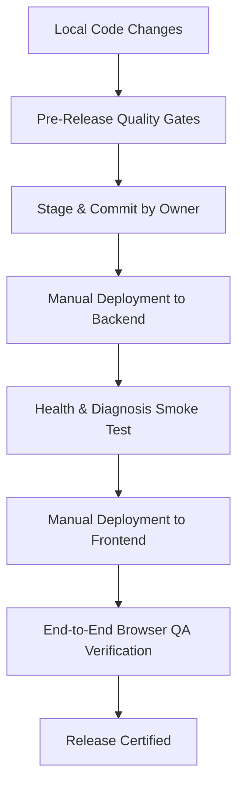

# 📦 BugBuddy — Release Process & Quality Gates

This document formalizes the release workflow, quality gates, and deployment readiness criteria for BugBuddy releases.

---

## 1. Release Lifecycle Stages



---

## 2. Pre-Release Quality Gates (Must Pass 100%)

Before any commit is published or marked for release, the following 5 verification commands must execute locally with **PASS** status:

### Gate 1: Knowledge Base Ingestion & Integrity
```bash
npm run validate:knowledge
```
- **Requirement**: All 60 records across all 6 canonical languages (C, C++, Java, Python, JavaScript, TypeScript) must ingest with 0 errors and 0 warnings.
- **Audit**: Must pass Stage 8 collision and corpus quality audits.

### Gate 2: Full Automated Unit & Integration Test Suite
```bash
npm test
```
- **Requirement**: All 27 test suites and 192 unit/integration assertions must pass with 0 failures, 0 skipped, and 0 errors.

### Gate 3: Retrieval Benchmark Evaluation
```bash
npm run evaluate:retrieval
```
- **Requirement**: BM25 and Hybrid RRF benchmarks must execute cleanly across development and held-out test cases.

### Gate 4: Local ONNX Semantic Embeddings
```bash
npm run verify:stage6
```
- **Requirement**: Transformers.js ONNX embedding pipeline (`Xenova/all-MiniLM-L6-v2`) must initialize and compute normalized 384-dimensional query vectors.

### Gate 5: Production Build & Type Checking
```bash
npm run build
```
- **Requirement**: `tsc` must pass with zero type errors. `vite build` must bundle static assets into `dist/` cleanly.

---

## 3. Deployment Coordination Workflow

1. **Verify Git Working State (Repository Owner)**:
   - Ensure `.env` is never staged or committed (guaranteed by `.gitignore`).
   - Ensure all changes are verified and clean.

2. **Backend Web Service First**:
   - Deploy `bugbuddy-backend` on the hosting provider (e.g. Render).
   - Ensure health check endpoint responds:
     ```bash
     curl -fsSL https://<BACKEND-URL>/health
     ```
   - Test diagnosis endpoint with a sample payload.

3. **Frontend Static Site Second**:
   - Provide the backend URL as `VITE_API_BASE_URL` in the frontend build settings.
   - Build and deploy static assets to the frontend host.
   - Test that SPA routing (`/*` -> `/index.html`) is active.

4. **Post-Release Sanity Audit**:
   - Run Confession Booth with buggy code.
   - Verify roast, diagnosis, suggested code fix, and +50 XP resolution.
   - Test multi-turn Debugging Chat workbench.
   - Check browser developer console for zero unhandled errors.

---

## 4. Emergency Incident & Rollback Protocol

If a fatal defect or third-party outage occurs post-release:

1. **Backend Failure / Provider Outage**:
   - BugBuddy's frontend contains an active client-side fallback engine. If the backend fails or returns 5xx, the app seamlessly provides deterministic knowledge retrieval without crashing.
   - In hosting dashboard, roll back the backend service to the last known stable deploy.

2. **Frontend Asset Breakage**:
   - Instant rollback in hosting dashboard to the prior stable deploy version.
   - Check asset caching and CDN headers.

3. **Credential Leak Prevention**:
   - If an API key is accidentally exposed in logs or user submissions, immediately revoke and regenerate the key at the provider console (Google AI Studio / OpenAI Platform).
   - Update the secret in the hosting dashboard. Redeploy the backend.
